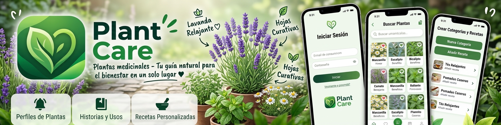

  

<h1 align="center">🌿 Evaluación de Julio</h1>

  <strong>Plant Care V1.0 · Experiencia de usuario</strong>

  
  

  🌿 ¡Cada opinión nos ayuda a mejorar Plant Care! 💚

---

## 👤 Mi información

| 📝 Dato | 💚 Información |
|:---|:---|
| **Evaluador** | Julio (`@Julio10Mon`) |
| **Planta representante** | 🌿 Manzanilla |
| **Versión de Plant Care** | `1.0 (Build 1)` |
| **Fecha de evaluación** | 25/10/2026 |
| **Modelo de teléfono** | Samsumg S24 Ultra |
| **Versión de Android** | 16 |
| **Estado general** | ⬜ Pendiente |

Credenciasles de acceso admin
correo: Julios@plantas.com
Contraseña: password
---

## 🎮 ¡Mis 10 pruebas!

Voy a revisar las funciones principales de Plant Care.

**Estados disponibles:**

- ⬜ Pendiente
- ✅ Funcionó correctamente
- ⚠️ Encontré un problema
- ➖ No pude probarlo

En cada fila cambiaré el estado, agregaré una calificación de **1 a 5** y escribiré lo que observé.

| N.º | 🌿 Prueba | Estado | ⭐ Nota | 💬 Mi comentario |
|:---:|:---|:---:|:---:|:---|
| 01 | 👑 Prueba de cuenta de administración | ✅ | 4 / 5 | Pude entrar al panel de administración y usar las pestañas Usuarios, Categorías, Recetas y Perfil. El perfil muestra correctamente el tipo de cuenta "Administrador". |
| 02 | 👤 Creación de usuario (Admin) | ✅ | 4 / 5 | La cuenta se creó, apareció en la lista y se mostró el mensaje "La cuenta fue creada". |
| 03 | 📄 Descarga de PDF de usuarios | ➖ | — / 5 | No llegué a probar el botón de PDF de la lista de usuarios. |
| 04 | 📂 Creación de categoría y receta | ✅ | 4 / 5 | Creé la categoría "Dolor de muela" y una receta con imagen; ambas aparecieron en las listas y la receta quedó publicada. |
| 05 | 🔐 Acceso en modo usuario | ⚠️ | 3 / 5 | Con correo y contraseña entré bien a la cuenta de usuario, pero **"Continuar con Google" no funciona** (ver Error 1). |
| 06 | 📱 Visualización y navegación general | ✅ | 4 / 5 | La barra inferior es clara y la navegación entre Explorar, Buscar, Favoritos y Perfil es fluida. |
| 07 | 🔍 Consulta de categorías y recetas | ✅ | 4 / 5 | Las categorías y sus recetas se abren correctamente y el detalle muestra ingredientes, preparación y beneficio esperado. |
| 08 | 📥 Descarga de receta medicinal | ⚠️ | 3 / 5 | Se genera el PDF, pero las viñetas de los ingredientes salen como cuadritos (▯) y no incluye la imagen de la receta (ver Error 2). |
| 09 | ⭐ Guardar y ver recetas en favoritos | ✅ | 4 / 5 | Al tocar el corazón, la receta quedó marcada en rojo y se mantuvo así en la tarjeta de la categoría. |
| 10 | 🌿 Experiencia general de la app | ⚠️ | 4 / 5 | Las funciones principales sirven y los colores son agradables, pero el diseño puede mejorar (ver observaciones de diseño). |

> 💚 Puedo consultar las instrucciones completas en la [guía de las 10 pruebas](../PLAN_10_PRUEBAS.md).

---

## ⭐ Mi escala de calificación

| Estrellas | Calificación | Significado |
|:---:|:---:|:---|
| ⭐ | 1/5 | Muy malo |
| ⭐⭐ | 2/5 | Malo |
| ⭐⭐⭐ | 3/5 | Regular |
| ⭐⭐⭐⭐ | 4/5 | Bueno |
| ⭐⭐⭐⭐⭐ | 5/5 | Excelente |

**Mi calificación general:** 4 / 5

**¿Por qué elegí esa calificación?**

La app cumple con sus funciones principales: crear usuarios, categorías y recetas, consultarlas, guardarlas en favoritos y generar el PDF. No le doy 5 porque el inicio de sesión con Google no funciona, el PDF tiene errores de formato y el diseño todavía se puede mejorar.

---

## 🐛 Reporte de errores

No es obligatorio encontrar errores.

Si algo falla, registraré la información siguiente.

### Error 1 · Inicio de sesión con Google

| 🔍 Información | 📝 Mi respuesta |
|:---|:---|
| **Función afectada** | Inicio de sesión con Google |
| **¿Qué intentaba hacer?** | Entrar a la app con el botón "Continuar con Google". |
| **¿Qué ocurrió?** | Apareció el mensaje "There was an error while trying to get your package certificate hash." y no inició sesión. |
| **¿Qué esperaba que sucediera?** | Que se abriera la selección de cuenta de Google y entrara a la app. |
| **¿Puedo repetir el problema?** | Sí |
| **Importancia del problema** | Alta |
| **Captura de pantalla** | Enlace opcional |

> 💡 **Posible solución:** este error suele aparecer cuando la huella SHA-1/SHA-256 de la llave con la que se firmó el APK no está registrada en Firebase. Conviene agregar ambas huellas en *Configuración del proyecto → App Android*, descargar de nuevo `google-services.json`, verificar que el proveedor Google esté habilitado en *Authentication* y volver a compilar. También sería bueno mostrar un mensaje en español, por ejemplo: *"No se pudo iniciar sesión con Google. Intenta con tu correo."*

### Error 2 · PDF de la receta: viñetas como cuadritos y sin imagen

| 🔍 Información | 📝 Mi respuesta |
|:---|:---|
| **Función afectada** | Descargar receta en PDF |
| **¿Qué intentaba hacer?** | Descargar una receta y abrir el PDF. |
| **¿Qué ocurrió?** | En "Ingredientes", la viñeta aparece como un cuadrito (▯) en lugar de un punto (•). Además, el PDF no muestra la imagen de la receta, aunque en la app sí aparece. |
| **¿Qué esperaba que sucediera?** | Ver la lista con viñetas normales y la imagen de la receta en el documento. |
| **¿Puedo repetir el problema?** | Sí |
| **Importancia del problema** | Media |
| **Captura de pantalla** | Enlace opcional |

> 💡 **Posible solución:** la fuente que trae por defecto el paquete `pdf` no incluye el carácter "•". Se puede cargar una fuente TTF (por ejemplo Roboto o Noto Sans) con `pw.Font.ttf(...)` o usar el widget `pw.Bullet`. Para la imagen, se pueden descargar los bytes de la foto y agregarlos con `pw.Image(pw.MemoryImage(bytes))` en la parte superior del PDF.

---

## 💬 Tres preguntas adicionales

### 💚 1. ¿Qué fue lo que más me gustó de Plant Care?

**Mi respuesta:**

La paleta de colores verdes va muy bien con el tema de plantas medicinales y la app es fácil de entender. Me gustó que cada receta tenga el aviso de que la información es educativa y no sustituye a un profesional de salud. También es útil poder guardar recetas en favoritos y generar el PDF.

### 🛠️ 2. ¿Qué mejoraría o cambiaría de la aplicación?

**Mi respuesta:**

Primero arreglaría el inicio de sesión con Google y el PDF (viñetas e imagen). Después mejoraría el diseño: le pondría un ícono propio a la app, usaría íconos distintos por categoría y le daría más contenido a la pantalla Explorar.

### 🌿 3. ¿Recomendaría esta aplicación a alguien interesado en la medicina natural? ¿Por qué?

**Mi respuesta:**

Sí, porque organiza las recetas por categoría de forma sencilla y permite guardarlas y compartirlas. Una vez que funcione el inicio con Google y se pulan el PDF y el diseño, sería todavía más fácil recomendarla.

---

## 📝 Mis observaciones adicionales

Aquí puedo comentar aspectos que no estén incluidos en las diez pruebas.

**🎨 Diseño y colores:**

Los colores verdes son agradables y consistentes con el tema. Estas son mis sugerencias para mejorar el diseño:

- **Ícono de la app:** la app usa el ícono predeterminado. Sería bueno crear uno propio (por ejemplo, la hoja verde del inicio de sesión) con `flutter_launcher_icons` y agregar una pantalla de bienvenida con `flutter_native_splash`.
- **Íconos de categorías:** todas las categorías usan el mismo ícono. Se verían mejor con un ícono o imagen distinta para cada una.
- **Pantalla Explorar:** solo tiene dos tarjetas y queda mucho espacio vacío. Podría mostrar recetas recientes o destacadas, o un carrusel de categorías con imagen.
- **Tarjetas de receta:** la categoría se repite encima del nombre. Sería más útil mostrar la planta o una breve descripción.
- **Perfil:** todos los datos llevan el mismo ícono de persona. Se entendería mejor con íconos distintos (correo ✉️, tipo de cuenta 🛡️, etc.).
- **Formulario de recetas (Admin):** el formulario y la lista están en la misma pantalla y hay que hacer mucho scroll. Funcionaría mejor dejar la lista con un botón flotante "+" que abra el formulario en otra pantalla.
- **Diálogo "Crear cuenta":** cuando aparece el teclado queda muy apretado. Podría ser una pantalla completa o una hoja inferior (*bottom sheet*).
- **PDF:** el texto es muy pequeño y queda mucho espacio en blanco. Se vería mejor con la imagen de la receta, un encabezado con el logo y letra más grande.

**📱 Facilidad de uso y navegación:**

La navegación es clara y la barra inferior se entiende sin necesidad de explicación.

**⚡ Velocidad y rendimiento:**

La app respondió rápido en general: las pantallas cargaron sin esperas largas y lo que creé apareció al momento.

**💡 Otras sugerencias:**

Revisar el diseño en pantallas con el teclado abierto, porque es donde más se nota la falta de espacio.

---

## 📸 Evidencias (opcional)

Puedo agregar capturas para explicar mejor mis comentarios.

No incluiré contraseñas, información privada ni datos de otras personas.

---

## ✅ Mi evaluación final

| 🌿 Elemento | Resultado |
|:---|:---|
| Pruebas revisadas | 9 / 10 |
| Problemas encontrados | 2 errores + sugerencias de diseño |
| Calificación general | 4 / 5 |
| ¿Terminé mi evaluación? | ✅ Sí |

### 💚 Mi conclusión

Plant Care cumple con lo principal: el administrador puede gestionar usuarios, categorías y recetas, y el usuario puede consultarlas, guardarlas en favoritos y obtenerlas en PDF. Lo más urgente es arreglar el inicio de sesión con Google y el PDF (viñetas e imagen). Con esas correcciones y las mejoras de diseño, sobre todo el ícono propio y una pantalla Explorar más completa, la app quedaría muy bien para presentarse.

---

## 📤 Entrega de Julio

**Fecha límite:** viernes 23 de octubre de 2026.

**Hora:** 11:59 p. m. (centro de México).

Guardaré mis respuestas en una rama propia y crearé un **Pull Request hacia `main`**.

Modificaré únicamente mi documento.

  
  

---

<h3 align="center">🌿 ¡Gracias por participar, Julio! 💚</h3>
